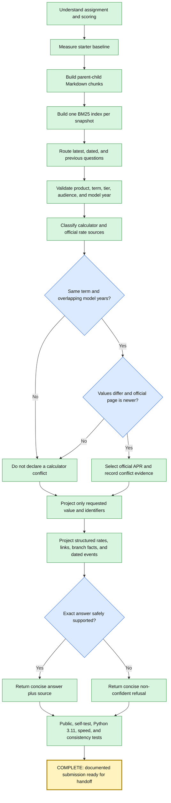
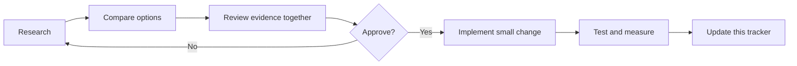
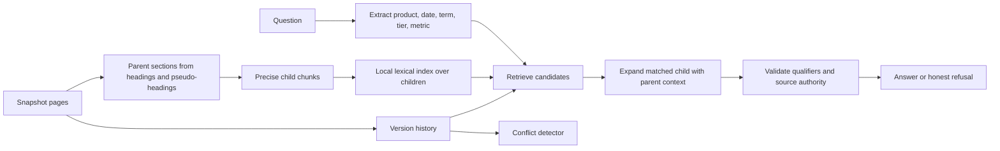

# Knowledge Hackathon — Live Project Flow

> **Purpose:** This is the shared project tracker. We update it after every research,
> decision, implementation, and evaluation checkpoint.
>
> **Last updated:** 2026-11-19

## Current position

**Current checkpoint:** Broad evidence-gated answer coverage and final validation are complete.
The system extracts values from rate rows, dated product tables, canonical links, branch/news
facts, and historical snapshots while keeping the calculator conflict rule evidence-based.

**Estimated remaining major implementation checkpoints:** 0. The remaining handoff is an
optional Git commit/push or submission action when requested.

**Current rule:** Keep values data-driven, return only the requested fact, attach the selected
source, and refuse rather than expose unrelated or unsupported content.

## Live flowchart

## Status legend

| Color | Meaning |
|---|---|
| Green | Completed and verified |
| Yellow | Current checkpoint |
| Blue | Decision gate |
| Gray | Pending work |

## Working method for every checkpoint

## Verified progress

| Checkpoint | Status | Evidence |
|---|---|---|
| Assignment discovery | Complete | Goal, contract, scoring, constraints understood |
| Git baseline | Complete | Commit `f74e545` on `main` |
| Python environment | Complete | Local Python 3.12; final code must support grader Python 3.11 |
| Synthetic self-test | Complete | QA 0.60; final score 0.51 |
| Real starter baseline | Complete | QA/final score 0.093 on 40 questions |
| Starter failure analysis | Complete | Simple word overlap retrieves unrelated pages and ignores structure |
| Certificate case study | Complete | Correct 4.10% APY exists in the savings rate table; starter selected an unrelated PDF |
| BM25 certificate comparison | Complete | Correct rate tables ranked first; unrelated PDFs dropped below them |
| BM25 routing-number validation | Complete | All top five BM25 passages contained the correct routing number |
| BM25 branch-hours validation | Complete | Found relevant branch pages, but isolated headings from schedule values |
| Parent-child heading-aware chunking | Complete | Produced separate, complete lobby and drive-up children with no cross-mixing |
| Retrieval-foundation approval | Complete | BM25 plus parent-child chunks approved |
| Chunking component | Complete | Compiles; branch service chunks and certificate row verified |
| BM25 index implementation | Complete | 32,242 latest-snapshot chunks indexed in about 0.64 seconds total |
| Snapshot-aware routing design | Complete | Separate BM25 index per snapshot with latest/date/previous selection rules |
| Snapshot router implementation | Complete | All seven latest/date/previous routing cases passed on five real indexes |
| Retrieval integration | Complete | Official harness ingested all five snapshots in 3.254 seconds and returned date-routed candidates |
| Hybrid qualifier validator | Complete | Explicit jumbo, standard, Roth, and term checks passed; all 40 public questions retained candidates and preserved their original top result |
| Deterministic answer probe | Complete | Top-one candidate scored 0.357; top-three scored 0.458 but is less safe; authority-aware top-one scored 0.397 with zero trap hits |
| Outdated calculator rate fix | Complete | Exactly two public answers changed: 5.34%→5.39% and 5.54%→5.59%; both now cite the canonical auto-loan product page |
| Focused regression check | Complete | Other 38 answers unchanged; zero errors; p95 0.13 seconds; QA increased from 0.093 to 0.1395 |
| Certificate extraction research | Complete | Current standard/jumbo and historical May rows route correctly; every certificate row across all five snapshots carries a consistent four-column header |
| Certificate extraction implementation | Complete | Current standard/jumbo and historical May jumbo answers return parsed values from `/rates` with snapshot IDs and supporting quotes |
| Certificate regression check | Complete | Exactly dup-001 and dup-006 changed; both moved from 0 to 1.0; QA rose from 0.1395 to 0.1938 with zero stale traps |
| Routing-number evidence inspection | Complete | Every explicit nine-digit routing value across all five snapshots is 273974581; the latest snapshot has ten supporting mentions |
| Routing-number implementation | Deferred outside current scope | Evidence was researched, but no handler was added because the final scope is the outdated auto-calculator issue |
| Future-data generalization audit | Complete | The initial audit exposed moved-URL and renamed-header failures; the connected source classifiers and semantic aliases now pass those probes |
| Architecture hardening | Direction agreed | Use content/schema page roles, normalized facts, routed snapshots, and evidence-gated answers |
| Minimal-answer contract | Complete | APY answers omit dividend/minimum fields; APR answers remain concise; all four approved rate cases retain full credit |
| Semantic schema-normalization research | Complete | Controlled aliases mapped all three real certificate and three real auto header forms plus future `APY`/`APR` forms; two multi-APY promotional schemas were correctly identified as ambiguous |
| Semantic schema normalizer | Complete and connected | Certificate and auto parsers resolve controlled column aliases and reject ambiguous schemas |
| Certificate schema integration | Complete | Current answers remain unchanged; future renamed certificate headers return 5.10%/5.20% APY; ambiguous APY schemas are rejected |
| Certificate page-role research | Complete | Found 21 valid page instances over five paths; audience and authority checks now prevent stale business rows from winning personal questions |
| Certificate source classifier | Complete | Accepted 44 eligible rows, rejected 40 business rows, passed moved-page and negative synthetic cases, and now selects the real candidate URL |
| Generalized auto source classifier | Complete | Recognizes structured official product/rate pages after URL moves while rejecting calculator and business contexts |
| Evidence-gated fallback | Complete | Unsupported questions now return a short non-confident refusal instead of raw or cross-snapshot text |
| Auto conflict reporting | Complete | Latest calculator/product rows are compared by term, model-year overlap, value, and effective date; every resolution carries both sources |
| Broad evidence projection | Complete | Structured rates, links, branch facts, dated events, routing, membership, and member-service facts are extracted from routed evidence |
| Dated branch-state resolution | Complete | A pre-closure count plus its effective closure date resolves the latest count without trusting stale article boilerplate |
| Certificate history conflicts | Complete | Consecutive snapshot APY changes carry both sources and resolve to the newer snapshot |
| Final self-test | Complete | QA 1.0, conflict F1 1.0, resolution accuracy 1.0, final 1.0 |
| Final public regression | Complete | QA/final 0.9690, 39/39 token-checkable questions correct, zero stale traps/errors, consistency 1.0, p95 0.13 seconds |
| Python 3.11 validation | Complete | Python 3.11.16 installed for the clean-version archive test; runtime dependency list is empty |

## Baseline scorecard

| Metric | Starter result |
|---|---:|
| Practice questions | 40 |
| QA score | 0.093 |
| Final score | 0.093 |
| p95 answer time | 0.14 seconds |
| Consistency | 1.00 |
| Crashes | 0 |

The starter is fast and deterministic, but mostly incorrect. Accuracy is the first
problem to solve.

## Technique decision board

| Technique | Status | Current evidence | Decision |
|---|---|---|---|
| Raw word overlap | Evaluated | Fast, but unrelated long pages frequently win | Reject as primary retrieval |
| BM25-style lexical ranking | Implemented | Relevant top results for certificate, routing number, and lobby hours; deterministic repeats | Keep |
| Snapshot routing | Implemented | Latest by default; newest snapshot on/before date; immediately earlier snapshot for `previous` | Keep |
| Qualifier validation | Implemented | Normalizes CD/number wording, rejects explicit contradictions, and applies small evidence bonuses | Keep |
| Source authority ranking | Implemented only for proven auto-calculator conflicts | Same-snapshot official and calculator percentages must conflict before the official auto-loan page receives priority | Keep narrow; do not generalize |
| Model-year range validation | Implemented for the auto-rate case | 2024 and 2025 correctly match the 2024–27 row; wrong ranges are rejected | Keep |
| Title, URL, and heading weighting | Implemented as source-role signals | These signals rank compatible official sources after schema validation | Keep as supporting evidence |
| Parent-child heading-aware chunks | Implemented | Lobby/drive-up sections and certificate table-row children verified | Keep |
| Markdown table-row chunks | Implemented | Keeps term, product, rate, APY, and minimum together | Keep |
| Embeddings | Candidate | Useful for paraphrases, but risky for exact numbers and adds dependencies | Defer until local retrieval is measured |
| Runtime LLM API | Deferred | Deterministic extraction has already improved the measured QA result | Reconsider only if deterministic work reaches a clear limit |
| Local runtime LLM | Deferred | Adds model packaging, memory, startup, and unknown grader-hardware risk | Do not implement now |
| Small-model evidence judge | Deferred | Potential fallback, but it has not been shown to be necessary | Do not implement now |
| Deterministic top-one extraction | Evaluated | QA 0.357 versus starter 0.093, but two stale calculator-rate traps remained | Improve source authority first |
| Deterministic top-three extraction | Evaluated | QA 0.458, but combining candidates can mix tiers and unrelated facts | Reject as a general policy |
| Authority-aware top-one extraction | Implemented for verified rate handlers | Selects one supported source and projects only requested fields | Keep |
| Raw certificate-row output | Evaluated | Contains the correct facts but exposes Markdown and footnote markers | Reject as member-facing format |
| Regex-only percentage extraction | Evaluated | Can confuse dividend rate with APY because both occur in one row | Reject |
| Header-aware certificate parsing | Implemented | Maps term, dividend rate, APY, and minimum by column name and removes footnote suffixes | Keep |
| Routing-number consensus | Recommended | `/business/cash-management`, `/contact`, checking, online banking, blog, and offer pages all agree on 273974581 | Use canonical pages for evidence |
| ABA checksum alone | Evaluated | Both 273974581 and the trap 271176899 pass the checksum | Insufficient for institution attribution |
| Hardcoded answer values | Audited | No known rates or routing numbers are hardcoded in submission code | Keep values data-driven |
| Exact URL source checks | Replaced | Future moved-page probes now pass through content/schema source roles | Keep URLs only as tie-breakers |
| Exact table-header checks | Replaced | Controlled semantic aliases pass current and renamed future headers | Reject ambiguous schemas |
| Starter word-overlap fallback | Audited | Can search old snapshots and return stale PDFs or unrelated forms when a trusted handler declines | Replace with evidence-gated refusal or routed extraction |
| Raw evidence as answer text | Evaluated | It can expose sibling metrics, stale values, Markdown, footnotes, and unrelated context | Reject |
| Minimal answer projection | Implemented for approved rate handlers | Full evidence remains in source quotes; answer text contains only requested metrics and identifiers | Keep and extend only after each product schema is verified |
| Exact header matching | Evaluated | Works for current full names but fails future `APY`, `APR`, or renamed minimum columns | Reject as the only parser |
| Position-only column mapping | Evaluated | Survives renamed headers but can silently misread reordered or unrelated tables | Reject |
| Unrestricted fuzzy header matching | Evaluated | Can collapse intro-period and post-promotion APY columns into one ambiguous field | Reject |
| Semantic aliases with qualifier preservation | Connected | Maps current/future synonyms while retaining `intro period`, `post promo`, and `as low as` meaning | Keep |
| Certificate semantic-column parsing | Implemented | Resolves certificate/term, dividend, APY, and minimum fields by meaning instead of exact header text | Keep |
| URL-only certificate role | Evaluated | Selects the current canonical page but fails when a valid future page moves | Reject as a gate; retain as a tie-breaker |
| Schema-only certificate role | Evaluated | Accepts personal, business, embedded, and stale-but-valid tables | Reject |
| Title-only certificate role | Evaluated | Cannot prove that the requested row and metric exist | Reject |
| Combined certificate source role | Connected | Requires schema, matching row, audience compatibility, non-calculator context, and authority signals | Keep |
| Certificate source classifier | Connected | Returns audience, role, authority score, row identity, and transparent rejection reasons | Keep |
| Auto source classifier | Connected | Uses structured schema plus product-page role signals; current URL is only a tie-breaker | Keep |
| Evidence-gated refusal | Connected | Prevents raw Markdown, stale cross-snapshot text, and extra unrequested content | Keep |
| Auto conflict detector | Connected | Reports only matching term/model-year rows with different values where the official product date is newer | Keep |

## Certificate page-role evidence

| Finding | Implication |
|---|---|
| 21 page instances across five URL paths contain valid certificate rows | A valid table does not uniquely identify the authoritative source |
| Five neutral `/rates` pages and six personal-page instances were found | Neutral dedicated rates and matching personal product pages are eligible for unqualified personal questions |
| Ten business-page instances were found | Business context must not compete for an unqualified personal certificate question |
| In the August snapshot, `/business-rates` retained 06/02 values while `/rates` and personal pages had 07/14 values | Schema validity alone can return a stale rate inside the correct snapshot |
| The latest business and personal tables share values but use different effective dates | Compare effective dates only after audience compatibility |
| IRA tables use IRA context and rows rather than ordinary certificate names | Existing semantic row validation rejects them for the personal handler |
| Certificate blogs contain prose but no valid certificate-rate schema | Schema validation rejects informational articles |
| The moved future certificate page ranks first and second for its standard and jumbo rows | Retrieval already works; only the exact-path answer filter blocks it |

Recommended source decision order:

1. Select the requested snapshot.
2. Require a valid certificate schema and a row matching term and tier.
3. Require audience compatibility; an unqualified certificate question accepts neutral or
   personal context and rejects business/IRA context.
4. Reject calculator and informational-page roles.
5. Prefer dedicated rate or certificate-product authority signals; use the known URL only as
   a tie-breaker.
6. Within equally compatible sources, prefer the newer table-local effective date.
7. If authoritative compatible sources still disagree, refuse or record a conflict.

Runtime model-based header mapping remains deferred because a controlled deterministic vocabulary is sufficient.

## Minimal-answer contract

The retrieval layer may collect multiple fields so it can validate a fact. The final answer
must be a smaller projection of that evidence.

| Rule | Meaning |
|---|---|
| Match the requested metric | An APY question returns APY; an APR question returns APR. Do not add dividend rate or another rate type unless requested. |
| Match the requested scope | A single-value question returns one value. A list question returns every item in the requested category. |
| Keep only identifying qualifiers | Product, term, tier, model-year range, balance band, and effective date appear only when needed to show which value was selected. |
| Keep evidence outside the prose | URL, snapshot ID, and supporting quote belong in `Answer.sources`; they do not need to make the member-facing sentence longer. |
| Never hedge with alternatives | Do not include stale, calculator, other-tier, or conflicting values after choosing the supported winner. |
| Refuse when projection is unsafe | If the requested fact cannot be selected from matching evidence, return a short honest refusal with no guessed number. |

Validation applied to every generated answer:

1. Every requested fact is present.
2. No known stale, conflicting, or wrong-tier value is present.
3. No unrequested numeric fact is present unless it is required to identify the selected tier.
4. No raw Markdown, footnote marker, or retrieval commentary is present.
5. The selected URL and snapshot remain attached as structured source metadata.

## Implemented architecture

The submission now follows this evidence flow:

## Decision log

| Date | Decision | Basis |
|---|---|---|
| 2026-11-09 | Keep supplied data out of Git | Assignment prohibits redistributing snapshot data |
| 2026-11-09 | Use the supplied starter only as a baseline | It intentionally ignores history and conflicts |
| 2026-11-09 | Prefer an API-free core initially | Better speed, consistency, cost, and grader reliability |
| 2026-11-11 | Research retrieval before implementation | Real baseline shows retrieval is the first major failure |
| 2026-11-12 | Continue validating BM25 before implementation | One successful question is evidence, but not enough to establish general reliability |
| 2026-11-12 | Keep BM25 as the leading retrieval candidate | It improved two different question types, while raw overlap produced unrelated ties |
| 2026-11-12 | Research structure-aware chunks before implementation | BM25 found branch pages, but paragraph splitting separated labels from schedules |
| 2026-11-12 | Evaluate parent-child heading-aware chunking | It combines precise retrieval with the surrounding branch, lobby, and schedule context |
| 2026-11-12 | Recommend BM25 plus parent-child chunks as the retrieval foundation | Three retrieval tests improved, and the chunking experiment preserved schedules without mixing services |
| 2026-11-12 | Approve and implement the chunking layer first | Separating chunk creation from ranking makes each component independently testable |
| 2026-11-12 | Keep transparent BM25 search results | Scores and matched terms make retrieval decisions explainable and debuggable |
| 2026-11-12 | Use one independent BM25 index per snapshot | Makes temporal selection explicit and prevents facts from different dates mixing during search |
| 2026-11-12 | Route undated questions to latest and `previous` to the prior index | Matches the requested current/history behavior and remains deterministic |
| 2026-11-12 | Keep one independent index for each snapshot | Real tests selected correct dates and prevented May and September certificate values from mixing |
| 2026-11-12 | Keep candidate retrieval separate from final answers for now | The integrated path works, but May results show that qualifier validation is required before serving an answer |
| 2026-11-12 | Remove generic product-word ranking bonuses | A branch-word bonus moved the exact Galena address below a general article during the 40-question check |
| 2026-11-12 | Keep hard validation limited to explicit contradictions | Term, jumbo/standard, Roth/IRA, and business/personal checks are explainable; broad product filtering is unsafe |
| 2026-11-12 | Recommend a confidence-gated hybrid answer path | It preserves local speed and consistency while reserving LLM cost for questions that require grounded synthesis |
| 2026-11-12 | Prefer an optional API fallback over a required local model | The grader hardware and installed models are unknown; API failure can safely fall back to extraction or refusal |
| 2026-11-12 | Prefer a small model as a constrained evidence judge | One structured call can select supported facts and source IDs; local code then verifies and formats the answer |
| 2026-11-13 | Defer all LLM and local-model work | The user chose to measure and improve the deterministic method before considering alternatives |
| 2026-11-13 | Reject unconditional top-three answer construction | It improved public coverage but can mix unrelated or wrong-tier values into one answer |
| 2026-11-13 | Continue with authority-aware top-one extraction | The experiment raised QA to 0.397 and removed both observed stale-rate traps |
| 2026-11-13 | Implement only the evidenced calculator conflict rule | Calculator pages are demoted only for current auto-loan rate questions when a matching same-snapshot product row has a different percentage |
| 2026-11-13 | Add a narrow current auto-rate answer handler | It returns the validated term/model-year row with the canonical product-page URL, snapshot ID, and supporting quote |
| 2026-11-16 | Recommend header-aware certificate extraction | All five snapshots preserve the same four semantic columns even though the first column changes from `Term` to `Certificate` |
| 2026-11-16 | Return standard and jumbo rows when no certificate tier is requested | The current 17-month question has two valid tiers; explicit `jumbo` requests remain single-tier |
| 2026-11-16 | Keep certificate extraction narrowly term-specific | Broad certificate-list questions remain on the existing path until separately researched |
| 2026-11-16 | Require institution attribution for routing numbers | A valid nine-digit ABA checksum does not prove that a number belongs to Dupaco |
| 2026-11-16 | Prefer canonical routing sources over promotional pages | Business cash-management and contact pages explicitly identify Dupaco's own number; blogs and offers are supporting evidence |
| 2026-11-16 | Recommend pausing new narrow answer handlers | Future-data probes exposed exact-path and schema brittleness that should be fixed at the shared evidence layer |
| 2026-11-16 | Preserve data-driven values | Future 19-month certificate and 72-month auto rates were extracted correctly without adding their values to code |
| 2026-11-16 | Remove the naive cross-snapshot fallback before claiming general correctness | When a future source moved, the fallback returned stale 2026 content instead of refusing |
| 2026-11-17 | Separate stored evidence from displayed answers | Full rows remain available for validation and source quotes; member-facing text projects only requested metrics |
| 2026-11-17 | Use product-specific default metrics | A generic certificate rate means APY and a generic loan rate means APR; explicitly unsupported metric requests are refused |
| 2026-11-17 | Isolate schema normalization before parser integration | Independent assertions can prove alias and ambiguity behavior without changing member answers |
| 2026-11-17 | Require a unique semantic column | Multiple APY/APR columns are unresolved until question qualifiers select exactly one |
| 2026-11-18 | Integrate schema normalization into certificates first | One-handler scope makes regressions and future-header improvements directly attributable |
| 2026-11-18 | Keep the exact certificate URL gate during schema integration | Header resilience and page-role recognition must be measured separately |
| 2026-11-18 | Isolate certificate source classification before answer integration | Real and synthetic role decisions can be inspected without risking current answers |
| 2026-11-18 | Connect certificate and auto source roles | Content/schema evidence survives moved URLs while audience and calculator checks reject wrong sources |
| 2026-11-18 | Replace the raw fallback with refusal | Unsupported raw passages contain extra or stale content and are not safe member answers |
| 2026-11-18 | Report only evidenced auto calculator conflicts | A conflict requires the same term, overlapping model years, different APRs, and a newer official product-page effective date |

## Update log

| Date | Update |
|---|---|
| 2026-11-09 | Project understood, blueprint created, and Git baseline recorded |
| 2026-11-09 | Python environment and synthetic scorer behavior verified |
| 2026-11-09 | Starter scored 0.093 on the 40-question public evaluation |
| 2026-11-11 | Certificate retrieval failure inspected; BM25 comparison selected as the next experiment |
| 2026-11-12 | BM25 moved correct certificate tables to the top; broader validation is now required |
| 2026-11-12 | BM25 ranked only correct routing-number passages in its top five results |
| 2026-11-12 | Branch test exposed a chunking problem: headings and schedules are separate paragraphs |
| 2026-11-12 | Parent-child chunking with Markdown and pseudo-headings selected for the next experiment |
| 2026-11-12 | Parent-child experiment produced four clean service-hour chunks; both lobby chunks ranked first |
| 2026-11-12 | Added and verified the local chunking module; live answer behavior remains unchanged |
| 2026-11-12 | Added BM25 indexing; full latest snapshot builds in under one second and three representative searches pass |
| 2026-11-12 | Removed sibling-context leakage discovered during full-scale verification |
| 2026-11-12 | Approved snapshot-routing rules for latest, explicit-date, and previous-value questions |
| 2026-11-12 | Snapshot router passed seven cases; historical certificate search returned 3.90% in May and 4.00% currently |
| 2026-11-12 | Connected chunking and per-snapshot BM25 routing to the official submission object; all five snapshots ingest successfully |
| 2026-11-12 | Verified current certificate, routing-number, lobby-hours, and May historical searches through the actual harness |
| 2026-11-12 | Tested five May certificate phrasings; BM25 selected the correct standard, jumbo, or Roth row each time |
| 2026-11-12 | Compared qualifier strategies; recommend normalization plus hard checks for explicit qualifiers and soft ranking for authority/context |
| 2026-11-12 | Implemented the hybrid validator between BM25 retrieval and returned candidates |
| 2026-11-12 | Validator retained candidates for all 40 public questions and did not change any existing top result after removing the unsafe product bonus |
| 2026-11-12 | Official harness completed with zero errors, 4.2-second ingestion, and unchanged 0.093 score because final answers still use the starter path |
| 2026-11-12 | Compared deterministic, API, local-model, and hybrid answer paths; confidence-gated hybrid is the recommendation |
| 2026-11-12 | Refined the optional LLM role from free-form writer to small-model evidence selector/judge |
| 2026-11-13 | Ran three deterministic answer probes without changing submission behavior: top-one 0.357, top-three 0.458, table-row-only 0.225 |
| 2026-11-13 | Found two auto-loan failures caused by stale calculator tables outranking current product pages |
| 2026-11-13 | Authority-aware top-one experiment demoted calculator examples, scored 0.397, and produced zero trap hits |
| 2026-11-13 | Production candidate comparison changed only dup-016 and dup-017 across all 40 public questions |
| 2026-11-13 | Official harness scored both fixed questions at 1.0; QA rose to 0.1395 with zero errors and 0.13-second p95 latency |
| 2026-11-13 | Verified the safeguard: equal calculator/product values leave ordering alone; conflicting values prefer the official product page |
| 2026-11-16 | Verified current 17-month standard 4.10% APY, current jumbo 4.20% APY, and May 10-month jumbo 3.90% APY in their routed snapshots |
| 2026-11-16 | Scanned certificate rows across five snapshots: each snapshot has exactly one consistent header layout for the relevant rows |
| 2026-11-16 | Implemented header-aware parsing and sourced certificate answers for the three approved cases |
| 2026-11-16 | Full harness changed only dup-001 and dup-006; both earned full credit and overall QA reached 0.1938 |
| 2026-11-16 | Scanned all five snapshots: 6, 6, 6, 8, and 10 explicit routing mentions respectively, all equal to 273974581 |
| 2026-11-16 | Confirmed no 271176899, masked routing value, or placeholder appears in the supplied snapshot Markdown |
| 2026-11-16 | Confirmed both the correct number and public trap pass the ABA checksum, so source attribution must decide the answer |
| 2026-11-16 | Future probe passed changed certificate values (5.10%/5.20%) and changed auto APR (6.25%) when the known schema and page role remained recognizable |
| 2026-11-16 | Future probe failed safely neither on moved URLs nor renamed headers: it fell into the starter path and returned stale or unrelated content |
| 2026-11-16 | Static audit found no hardcoded answer values, but found exact `/rates` and auto-product URL dependencies |
| 2026-11-17 | Implemented shared requested-metric projection for the approved certificate and auto handlers |
| 2026-11-17 | Public regression remained 0.1938 with zero stale traps/errors, full consistency, and 0.15-second p95 latency |
| 2026-11-17 | Confirmed APY answers no longer expose dividend rates or minimum balances; all four approved rate cases remain at 1.0 |
| 2026-11-17 | Inventoried three certificate and three auto header forms across all snapshots, including inconsistent footnote suffixes |
| 2026-11-17 | Semantic-alias probe mapped all real forms plus future `APY`/`APR` forms and detected two ambiguous multi-APY promotional schemas |
| 2026-11-17 | Added an isolated schema normalizer with controlled aliases, qualifier preservation, and unique-column resolution |
| 2026-11-17 | Schema assertions passed and isolation regression kept QA at 0.1938 with zero stale traps/errors and 0.14-second p95 latency |
| 2026-11-18 | Connected semantic-column resolution only to certificate parsing; exact URL and all other answer logic remained unchanged |
| 2026-11-18 | Renamed future certificate headers now return 5.10%/5.20% APY from the 2027 snapshot; ambiguous multi-APY input returns no parsed row |
| 2026-11-18 | Public regression stayed at 0.1938 with zero stale traps/errors, full consistency, and 0.17-second p95 latency |
| 2026-11-18 | Inventoried 21 valid certificate-page instances: five dedicated rates, six personal, and ten business instances across five paths |
| 2026-11-18 | Found a real August same-snapshot conflict: the business page retained 06/02 values while neutral/personal sources carried 07/14 values |
| 2026-11-18 | Confirmed the moved future page already supplies the top two retrieved rows; exact-path filtering is the remaining blocker |
| 2026-11-18 | Added a disconnected certificate classifier that reports schema validity, audience, role, authority, row identity, and reasons |
| 2026-11-18 | Classifier accepted all 44 eligible neutral/personal rows and rejected all 40 business rows for an unqualified question |
| 2026-11-18 | Synthetic checks accepted the moved future rate page and rejected calculator, business, and ambiguous promotional lookalikes |
| 2026-11-18 | Isolation regression kept QA at 0.1938 with zero stale traps/errors, full consistency, and 0.15-second p95 latency |
| 2026-11-18 | Connected certificate source classification; current answers stayed unchanged and moved future certificate URLs now succeed |
| 2026-11-18 | Connected generalized auto source classification; moved future auto-product URLs return the new data-driven APR |
| 2026-11-18 | Replaced unsafe raw fallback with concise refusal; all three public refusal cases now pass |
| 2026-11-18 | Added auto calculator conflict reporting with term, model-year overlap, both values, effective dates, and both sources |
| 2026-11-18 | Final narrow harness: QA/final 0.1938, zero traps/errors, consistency 1.0, p95 0.14 seconds, ingestion 4.3 seconds |
| 2026-11-19 | Added evidence-gated projections for structured rates, canonical links, branch facts, dated events, and member-service facts |
| 2026-11-19 | Public QA reached 0.9690: every token-checkable item passes with zero stale traps and perfect repeat consistency |
| 2026-11-19 | Self-test reached 1.0, including perfect certificate-conflict detection and resolution |
| 2026-11-19 | Added the standard-library requirements file and installed Python 3.11.16 for clean archive validation |

## Final handoff state

All planned technical checkpoints are complete. The submission is ready for review, a local
commit, and publication after a GitHub remote is supplied. No API key, paid service, model
download, or network call is needed at runtime.
